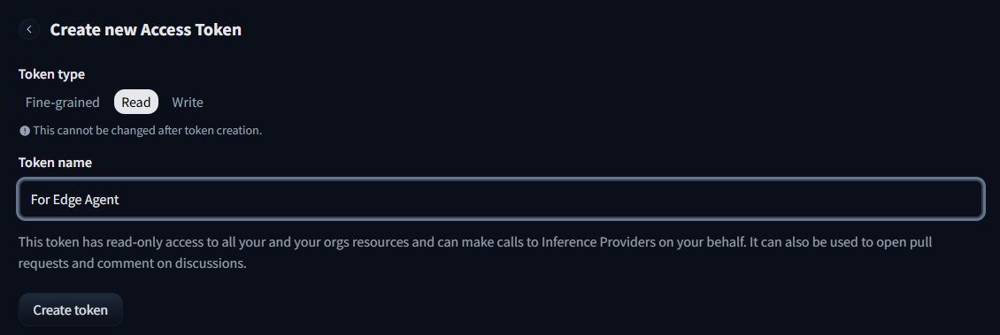

# Advantech Edge Agent

📢 **Edge Agent v4.0.0 now supports both Jetson AGX Thor and Jetson AGX Orin (JetPack 7.2)!**

**Looking for an earlier version?**
- Jetson Thor with JetPack 7.0: switch to the [tag v3.0.0](https://github.com/advantech-EdgeAI/Edge_Agent/tree/v3.0.0).
- MIC-733 with JetPack 6.0: switch to the [tag v2.0.0](https://github.com/advantech-EdgeAI/Edge_Agent/tree/v2.0.0).

Advantech Edge Agent is an interactive sandbox for quickly designing and testing automation agents, personal assistants and edge AI systems. It connects these to live cameras, sensors and I/O:
- multimodal Large Language Models (LLMs) and Vision Language Models (VLMs);
- speech and vision transformers;
- vector databases;
- prompt templates and agent tool calling.

It runs entirely on Jetson devices: on-device computing, low-latency streaming and unified memory, and fully offline once the models are installed.

<a href="https://youtu.be/bKSFZuh24Yc"></a>

## Key Features

- **Interactive Environment**: Design and test automation agents and personal assistants in a browser-based node editor.
- **Multimodal Integration**: Combine LLMs and VLMs with speech and vision transformers for comprehensive AI solutions.
- **Agents that See and Act**: A VLM-driven agent calls tools to read live camera frames, track objects and answer questions about the scene. Risky actions wait for your confirmation in the browser.
- **Voice Interaction**: Wake word, speech recognition and spoken replies in Chinese and English.
- **Event Recording**: Alerts save a video clip, and a VLM writes a summary of each event.
- **Real-Time Sensor Integration**: Connect and interact with live sensors and I/O for real-world applications.
- **Optimized for Jetson Devices**: One Docker image for Jetson AGX Thor and AGX Orin, with on-device computing and low-latency streaming.

> 💡Learn more about [Preset Projects](https://github.com/advantech-EdgeAI/edge_agent/wiki/03-preset-projects) of using Edge Agent in wiki.

> 💡Watch a quick intro video [here](https://www.youtube.com/watch?v=P6T5xecStjk).

## System Architecture

Advantech Edge Agent is built on Agent Studio from Jetson AI Lab, enhanced with additional custom features. Users may find these helpful:
- the [official tutorial](https://www.jetson-ai-lab.com/archive/agent_studio.html);
- the [Jetson Forums](https://forums.developer.nvidia.com/c/agx-autonomous-machines/jetson-embedded-systems/jetson-projects/78);
- [GitHub Issues](https://github.com/dusty-nv/NanoLLM) from NVIDIA.

## Installation Guide

### System Requirements

| Name            | Description                                           |
|-----------------|-------------------------------------------------------|
| Product         | MIC-742-AT / MIC-743-AT (Jetson AGX Thor), MIC-733AO (Jetson AGX Orin 64GB) |
| JetPack Version | V7.2 (Thor and Orin)                                  |
| Storage         | NVMe SSD with at least 256 GB (Thor and Orin)         |
| USB Camera      | Logitech c270 HD webcam or any V4L2 compatible camera |
| Internet        | Required during installation                          |

### 1. Clone this Repository

Clone this repository to your JetPack 7.2 device:

```sh
git clone https://github.com/advantech-EdgeAI/edge_agent.git
cd edge_agent
```

### 2. Docker Service Installation

Check the Docker version to ensure that the Docker service is installed and running properly on your system:

```bash
docker --version
```

If Docker is not available, follow [the guide](https://github.com/advantech-EdgeAI/VSS/issues/2) to install Docker.

Edge Agent needs GPU access in Docker. If `docker info | grep Runtimes` does not list `nvidia`, run once:

```bash
sudo apt install -y nvidia-container-toolkit
sudo nvidia-ctk runtime configure --runtime=docker
sudo systemctl restart docker
```

### 3. Pull the Docker Image

The image is ~23 GB to download and ~70 GB once extracted. Ensure your disk has sufficient free space before pulling.

```bash
docker pull ispsae/nano_llm:4.0.0-jp7
docker tag  ispsae/nano_llm:4.0.0-jp7 edge_agent_jp7:latest
docker rmi ispsae/nano_llm:4.0.0-jp7
```

### 4. Extract the Data Package

The data package contains the pre-compiled VILA models (MLC, for Thor and Orin), YOLO-World / YOLOE weights, Piper voices, demo videos, sample images and the RAG demo database (~10 GB to download, ~13 GB extracted). Once extracted, remove the image to free its space.

```bash
mkdir -p data
docker run --rm -v $(pwd)/data:/data ispsae/edge_agent_data:4.0.0-jp7
docker rmi ispsae/edge_agent_data:4.0.0-jp7
```

Other models are downloaded or built the first time a preset uses them: the vLLM models (Qwen3.8, Cosmos, Qwen3-VL, …) and the Whisper and Kokoro speech models are downloaded, and the TensorRT engines (CLIP, OwlV2, Whisper) are built for your device (a few minutes, once).

After extraction, your project structure will look like:

```
edge_agent/
├── data/
│   ├── models/
│   │   ├── mlc/dist/      ← pre-compiled VILA models (MLC, Thor and Orin)
│   │   ├── YoloWorld/     ← YOLO-World weights (detection, tracking, auto-labeling)
│   │   ├── YOLOE/         ← YOLOE weights (tracking by a drawn box)
│   │   ├── whisper/       ← voice activity detection model
│   │   └── piper/         ← Piper TTS voices
│   ├── nanodb/            ← database for the RAG demo
│   ├── videos/demo/       ← demo video files
│   ├── images/            ← sample images
│   └── ...
├── start.sh
└── .env
```

### 5. Configure Hugging Face Access Token

Please go to Hugging Face official website to [generate your personal access token](https://huggingface.co/settings/tokens) for pulling models from Hugging Face. You will only need to generate the one with ***read*** permission.



Copy `.env` file:

```bash
cp .env.example .env
```

Edit `.env` and set your token:

```bash
HUGGINGFACE_TOKEN=hf_xxxxxxxxxxxxxxxxxxxxxxxxxxxxxxxx
```

Please keep your token safely. Do not share it with others.

Some models are gated (for example `nvidia/Cosmos-Reason2-2B`, and `nvidia/Cosmos-1.0-Guardrail`, which the video generator downloads for its safety check): open the model page on Hugging Face once and accept its terms with the same account, or the download fails.

The token is only needed to download models. Each model is downloaded the first time a preset uses it. Without `.env`, Edge Agent starts offline and uses only the models already in `data/models`.

## Usage / Quick Start

### 1. Start Edge Agent

Start the Edge Agent, and the backend will listen on port 8050 on localhost:

```bash
bash start.sh
```

After ~20 seconds, open a browser and go to:

```
https://<YOUR_DEVICE_IP>:8050
```

### 2. Check the Log

```bash
docker logs -f edge_agent_run
```

### 3. Start a Quick Demo Project

In Studio, open **Agent → Load** in the toolbar and pick a preset project for a quick demo.

### 4. Show the Display Page

Click **Display Mode** in the Studio toolbar, or open `https://<YOUR_DEVICE_IP>:8050/kiosk?screen=auto`, for a full-screen demo page of the current preset. Press **L** to switch between Chinese and English.

### 5. Stop Edge Agent

```bash
docker stop edge_agent_run
```

## Third-Party Models

Edge Agent runs models made by other organizations, and each keeps its own license. See [THIRD_PARTY_MODELS.md](./THIRD_PARTY_MODELS.md) before using a model in a product. VILA1.5 is for non-commercial use only, and YOLO-World and YOLOE are under AGPL-3.0.

## Troubleshooting

We maintain frequently asked questions as GitHub Issues. This allows for better tracking, discussions, and updates.

How to Find Answers:
- Check the [FAQ label](https://github.com/advantech-EdgeAI/edge_agent/issues?q=is%3Aissue%20state%3Aclosed%20label%3AFAQ) in Issues to see if your question has already been answered.
- Use the search bar in the Issues tab to find relevant discussions.
- If you can’t find what you need, feel free to open a new issue with your question!

Looking for tech support or have a business inquiry? Let’s talk: [Contact Form](https://www.advantech.com/en/form/2bcb7004-44e9-4e70-9ef0-520f326e6141?callback=f51f1493-33ae-43e5-8172-cb8055499ec1)
